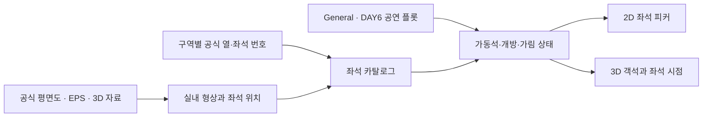

# KSPO DOME 개발 계획

2026-11-22 · Song2Concert · 기준 커밋 `a4d9676`

리모델링 후 실내를 기준으로 새 베뉴 **KSPO DOME**을 구현한다. 현행 Song2Concert의 공용 렌더러, 공연 장비, 좌석 피커, 이동 시스템을 사용하고, 베뉴 전용 형상과 좌석 데이터를 공식 자료에서 새로 만든다. **General과 360°를 동시에 출시**한다. General은 A 블록 쪽 엔드 스테이지, 대형 백스크린, 일자 돌출 무대, 착석 플로어를 기본안으로 한다. 360°는 **2025년 5월 DAY6 3RD WORLD TOUR 〈FOREVER YOUNG〉 FINALE in SEOUL**을 기준으로 한다. 양쪽 모드에서 공식 구역·열·좌석 번호로 좌석을 고르고 해당 3D 시점으로 이동하는 것이 목표다. 1층은 두 모드 모두 중간 통로 전면 가동석을 수납한다. [현행 베뉴 등록부](../src/three/venues/index.js) · [운영사 자료](https://www.ksponco.or.kr/olympicpark/menu.es?mid=a10405050100) · [DAY6 공식 배치도](https://tkfile.yes24.com/Upload2/Board/202503/20250331/map.jpg)

[도면·사진·영상 레퍼런스 모음](references/GYMNASTIC_ARENA_REFERENCES.ko.md)

## 현재 빌드

- 운영사 EPS의 11열과 12열 라벨 사이와 DAE 좌석의 간격을 대조했다. B·C 쪽 예시에서 약 32.4–32.9m의 11열과 약 34.2–34.7m의 12열 사이가 일반 열 간격의 두 배다. 두 모드에서 1–11열 위치를 접고, 무대 배치에 따른 개방 상태를 적용했다. [공식 EPS](https://www.ksponco.or.kr/attachFiles/download/kspo/popimg_acro_seat.zip) · [공식 DAE](https://www.ksponco.or.kr/attachFiles/download/kspo/kspodome_dae.zip)
- 운영사 모델에서 수납 후 1F 좌석 위치 3,766개와 상부 좌석 후보 위치 7,744개를 추출했다. 52개 구역의 지오메트리를 EPS 구역표와 벡터 경계선에 맞췄다. 설치 모델의 좌표와 임시 번호를 연결한 시점은 앱에서 확인할 수 있으며, 운영사 최신 좌석 원장과 BOX·휠체어 좌석 식별자는 추가 대조가 필요하다. [재현 파이프라인](../venue-lab/pipeline/gymnastic_arena.py)
- 메인 앱과 Venue Dev Lab에서 두 모드를 사용한다. General은 35.4m 폭의 모델 백스크린과 일자 런웨이, 360°는 DAY6 자료에 맞춘 원형 무대, S1–S6, 19구역 FOH를 배치했다. 두 시뮬레이션의 스크린·PA 치수와 정확한 장비 개수는 공개 자료를 바탕으로 정한 모델값이다. [공유 스테이지 평면](../src/three/gymnastic-arena-plan.js) · [DAY6 예매 도식](https://tkfile.yes24.com/Upload2/Board/202503/20250331/map.jpg)
- Arena의 라인 어레이 지향성·흡음 곡선을 출발점으로 체적, 표면적, PA 및 FOH 좌표를 맞췄다. 중역 RT60 모델값은 General 2.63초, 360° 2.43초다. [음향 설정](../src/audio/venuerooms.js)

## 1. 초기에 확정할 사실과 기준

| 항목 | 확인한 사실 | 구현 판단 |
| --- | --- | --- |
| 시설 기준 시점 | 해안건축의 시설개선 프로젝트는 2018년 준공으로 기록돼 있다. 문체부는 2024년 자료에 두 차례 리모델링을 기록했다. 2025년 DAY6 공연 사진에는 노출된 실내 철골과 음향 패널, 여러 색 좌석과 상부 박스 구역이 보인다. [해안건축](https://www.haeahn.com/ko/project/detail.do?prjctSeq=1959) · [문체부 시설 현황](https://www.mcst.go.kr/servlets/eduport/front/upload/UplDownloadFile?pFileName=%280814%29%EB%AC%B8%EC%B2%B4%EB%B6%80%EB%B3%B4%EB%8F%84%EC%9E%90%EB%A3%8C-%EC%98%AC%EB%A6%BC%ED%94%BD%EA%B3%B5%EC%9B%90_%EB%B3%B5%ED%95%A9%EB%AC%B8%ED%99%94%EC%98%88%EC%88%A0%EA%B3%B5%EA%B0%84%EC%9C%BC%EB%A1%9C_%ED%99%9C%EC%84%B1%ED%99%94_%EB%B0%A9%EC%95%88_%EB%85%BC%EC%9D%98.pdf&pPath=0302000000&pRealName=20240814082056658396766489_PRESS20240814082056245065.pdf) · [DAY6 현장 사진](https://minniestory.com/132) | 2025년 공연 사진과 공개 3D 자료에서 일치하는 실내를 기준으로 한다. 1988년 자료는 케이블 돔의 원형과 연혁을 파악하는 데 쓴다. |
| 건물 층과 티켓 층 | 운영사 층별 평면과 공연별 좌석도의 층 표기가 다르다. 지상 1층이 플로어, 지상 2·3층의 계단식 객석이 DAY6 티켓의 1F·2F에 해당한다. [공식 시설 평면도](https://www.ksponco.or.kr/olympicpark/menu.es?mid=a10405050100) · [YES24 좌석도](https://tkfile.yes24.com/Upload2/Board/202503/20250331/map.jpg) | UI는 `FLOOR / 1F / 2F`를 쓴다. 데이터에 건물 층과 티켓 층을 각각 저장한다. BOX와 휠체어 구역은 실제 층과 연결해 표시한다. |
| 구역과 예외 | 하부 스탠드는 B 1–4, C 5–11, D 12–15, A 16–22다. 상부는 23–52이며 박스 객석과 접근성 구역이 별도로 있다. 공식도에서 23·44의 형상은 인접 구역과 다르고, 48·49 앞쪽에는 큰 개구부가 보인다. [운영사 간략도](https://www.ksponco.or.kr/olympicpark/img/sub/s3_01_03_seat.jpg) · [운영사 EPS](https://www.ksponco.or.kr/attachFiles/download/kspo/popimg_acro_seat.zip) | 52개 구역을 모두 식별한다. 반복되는 좌석 띠와 단은 공유 형상으로 생성하고, 실제 개구부·좌석이 끊기는 열·구역 경계는 개별 데이터로 적용한다. |
| 좌석 수 | 운영사 웹 구역 합계 13,949석(1–22 합 6,472, 23–52 합 7,477), EPS 중앙 집계 14,151석, 제공 3층 도면의 공사 후 합계 14,352석, 대관 FAQ 14,923석이 공존한다. 공연장 소개에는 14,594와 15,000이 함께 나온다. JYP가 발표한 DAY6 회당 약 16,000명은 플로어 스탠딩을 포함한 행사 관객 수다. [공연장 안내](https://www.ksponco.or.kr/olympicpark/menu.es?mid=a20301030800) · [EPS](https://www.ksponco.or.kr/attachFiles/download/kspo/popimg_acro_seat.zip) · [3층 도면](https://www.ksponco.or.kr/attachFiles/download/kspo/popimg_acro_3f.pdf) · [대관 FAQ](https://www.ksponco.or.kr/culture/contents/guide/qa.do) · [JYP 발표](https://recruit.jype.com/ko/news/4) | 원본별 수치를 좌석 감사표에 남긴다. 앱의 모드별 선택 가능 좌석 수는 카탈로그에서 계산하고, 스탠딩 수용 규모는 별도 정보로 다룬다. |
| EPS 내부 차이 | EPS 중앙 표는 **42구역 244 / 접근성 82 / BOX 121**을 적는다. 같은 EPS 외곽의 개별 라벨은 **42구역 245 / 접근성 84 / BOX 1–8 합 115**를 적는다. 단순 확대 화면의 좌석 기호에는 개별 좌석 번호가 보이지 않는다. [운영사 EPS](https://www.ksponco.or.kr/attachFiles/download/kspo/popimg_acro_seat.zip) | 충돌한 값은 좌석 도형, 현장 좌석 표지, 운영사 최신 자료를 대조해 확정한다. 구역 합계에 맞추기 위해 임의로 좌석을 추가하거나 제거하면 감사표에서 검출되게 한다. |
| 3D 모델과 공연 시야 | 운영사는 SKP와 DAE를 제공한다. 열어 본 SKP ZIP에는 `KSPO-dome2015.skp`가 있으며 ZIP 내부 파일은 2023년 타임스탬프다. DAE 원본은 SketchUp 22가 만든 COLLADA 1.4.1이며 인치 단위, Z-up이다. 검사한 DAE 노드 83,322개의 이름은 대부분 일련번호로, 실제 좌석 번호는 확인되지 않았다. 파일명과 파일 날짜는 현장 기준 연도를 확정할 근거로 쓰기 어렵다. 공개 EPS는 좌석 위치와 여러 열 표기를 제공하고, 예매 배치도는 공연별 개방 구역을 제공한다. [운영사 다운로드](https://www.ksponco.or.kr/olympicpark/menu.es?mid=a10405050100) · [공공데이터 카탈로그](https://www.data.go.kr/data/15127487/fileData.do) | 3D 원본은 치수·높이·인스턴스 위치 비교에 활용한다. 공식 좌석 번호는 발권표, 번호 표지, 운영사 좌석 데이터에서 확보한다. 모델에서 번호 메타데이터가 나오는지도 확인한다. |

## 2. 좌표와 실내 모델

- **좌표 기준**을 아레나 바닥 중심 `(0, 0, 0)`으로 잡고 미터 단위를 사용한다. General 무대 쪽 A 블록·GATE 1-1 방향을 `-z`, C 블록·GATE 2-2 방향을 `+z`, DAY6 좌석도 기준 B 블록(1–4)을 `+x`로 둔다. EPS, 웹 좌석도, DAY6 도식의 회전이 서로 달라 각 원본을 독립 변환한다. 중심, 아레나 외곽, GATE 1-1/2-2, 좌우 대각 통로, B·D 구역 번호로 회전과 좌우를 검증한다. [공식 간략도](https://www.ksponco.or.kr/olympicpark/img/sub/s3_01_03_seat.jpg) · [DAY6 좌석도](https://tkfile.yes24.com/Upload2/Board/202503/20250331/map.jpg)
- **치수 표**에는 바닥 외곽, 고정·수납식 관중석 첫/마지막 열, 상·하부 층고, 난간 높이, BOX 전면과 상부 벽, 지붕 최저·최고점, 트러스 하단을 적는다. 각 숫자에 버전, 단위, 출처, 오차를 붙인다. 3D의 단위 메타데이터와 도면에서 읽힌 랜드마크 간 거리를 먼저 맞춘다. 오픈 상태의 객석 내경과 관중석 수납 후 바닥 사용 경계를 각각 기록한다. [대관용 층별 도면 및 모델](https://www.ksponco.or.kr/olympicpark/menu.es?mid=a10405050100)
- **아레나 볼**은 바닥, 하부 가동석과 고정 단, 상부 계단식 객석, BOX 1–8, 객석 뒤 콘코스, 난간·통로·개구부를 포함한다. GATE 1-1/1-2/1-3 및 2-1/2-2/2-3은 도면 기준으로 모델링한다. 관객 진입 테스트는 대관 FAQ의 2-1/2-2/2-3을 우선한다. C 블록 뒤 접근성 플랫폼의 출입, 평탄부, 난간, 동반석·공간 표기를 확인한다. 콘코스는 객석에서 보이고 걸어서 좌석으로 이동할 수 있는 범위까지 제작한다. 외부 광장·외벽 전체·분장실·실외 탐색은 이번 출시 범위 밖으로 둔다. [공식 층별 도면](https://www.ksponco.or.kr/olympicpark/menu.es?mid=a10405050100) · [대관 FAQ](https://www.ksponco.or.kr/culture/contents/guide/qa.do) · [현장 접근성 지도](https://web.staircrusher.club/articles/kspo-dome-concert-hall-accessibility)
- **지붕과 재질**은 실내에서 보이는 방사형·격자 철골, 중앙부, 외곽 구조, 흡음 패널, 고정 조명과 공조구를 사진에 맞춘다. 공연 트러스는 별도 레이어로 걸어 house/show 비교 시 시설과 장비를 구별할 수 있게 한다. 좌석은 빈 공연장 사진으로 등받이 형상과 설치 색을 확인하고, 공연 컬러 조명을 끈 상태에서 색을 맞춘다. [설계사 빈 객석 전경](https://www.haeahn.com/upload/prjctmain/20181109111748017566.jpg) · [DAY6 플로어 실사](https://minniestory.com/132)
- **공용 모델링 경로**는 `venue-lab/pipeline/`의 독립 KSPO 입력·생성 단계와 `src/three/stands.js`의 메시·좌석 인스턴스 경로다. 생성물은 좌석과 구조를 별도 파일로 빌드하고, 문/난간/계단의 시각 메시와 충돌 메시를 같은 외곽선에서 만든다. 공식 파일은 출처 확인과 치수 추출에 쓰고, 런타임에서는 자체 제작한 경량 형상과 생성 데이터로 표시한다. [공용 스탠드 렌더러](../src/three/stands.js) · [공용 보행 시스템](../src/three/walk.js) · [기존 데이터 생성 방식](../venue-lab/README.md)

## 3. 공연 모드

### General

1. A 블록 쪽의 직사각형 본무대에 대형 백스크린과 일자 돌출, 후면 가림막을 둔다. 돌출 깊이와 폭은 착석이 가능한 플로어 폭, 모서리 입구와 카메라 통로, 스피커 각도를 확인하고 정한다. 확정한 범위에 따라 착석 플로어의 구역·열·좌석에는 앱 전용 번호를 부여하고, `FLOOR` 아래에 표시한다. 현장 공식 좌석 매핑은 영구·가동 관중석에 적용한다. [일반 엔드 스테이지 비교 자료](references/GYMNASTIC_ARENA_REFERENCES.ko.md#general-공연과-시야-제한-사례)
2. 객석 물리 상태와 입장 가능 상태를 따로 정의한다. 수납된 좌석은 접혀 있는 구조로, 가림막 뒤 좌석은 실제 좌석과 단이 남아 있는 상태로 그린다. 끝 무대 옆 구역은 스크린·드레이프·PA·무대 측벽에 대한 가림을 검사해 좌석 단위로 개방, 시야 제한, 닫힘을 설정한다. 태연·RIIZE의 공식 공연 지도에서 본무대·콘솔·끝쪽 개방 구역을 대조하고, 이번 General 플롯의 가림 판정을 기준으로 A 블록과 상부 후면의 개방 범위를 정한다. [RIIZE 시야 제한석 공지](https://weverse.io/riize/notice/27462?hl=ko) · [태연 시야 제한석 공지](https://weverse.io/girlsgeneration/notice/25023?hl=ko)
3. FOH는 돌출 무대 바깥 플로어 후방 중앙에 둔다. 메인·사이드 어레이, 서브, 프런트 필, 카메라 포지션, 펜스, 관객 통로를 하나의 평면 위에서 배치한다. 좌석·카메라·통로의 충돌 검사와 2D 피커의 무대 실루엣은 동일한 플롯에서 생성한다. [공용 무대 평면 계약](../src/three/stage-plan.js) · [현행 공연 장비 렌더링](../src/three/concert-production.js)

### 360° DAY6 2025년 5월 피날레

| 요소 | 재현 범위 |
| --- | --- |
| 플롯 | 원형 본무대와 높은 중앙 드럼 라이저를 배치한다. 공식도에 맞춰 피커에서 B 쪽을 `S1`로 두고 시계방향으로 `S2 → S3 → S4 → S5 → S6`을 배치한다. S1·S4가 양쪽의 넓은 부채꼴이다. 6개 구역과 원형 무대 사이의 완충 및 방사형 펜스·통로는 현장 사진으로 보정한다. 360° 모드의 플로어는 스탠딩 구역과 대표 시점으로 제공한다. [YES24 공식 배치도](https://tkfile.yes24.com/Upload2/Board/202503/20250331/map.jpg) · [스탠딩 전·후방 시점](https://minniestory.com/132) |
| 관중석과 콘솔 | 1F의 18과 20 사이에 표시된 **CONSOLE**에 FOH를 둔다. 19구역은 건물 좌석 데이터에 보존하고, 공연 판매 상태는 별도 적용한다. 2F 23–52 개방을 배치도에서 대조한다. 플로어 접경의 좌석 적층선은 현장 사진과 비교해 가동석 수납 범위를 확정하고, 8구역 앞 난간과 카메라 플랫폼을 검증한다. [YES24 공식 배치도](https://tkfile.yes24.com/Upload2/Board/202503/20250331/map.jpg) · [8구역과 맞은편 콘솔이 보이는 현장 자료](https://minniestory.com/132) |
| 무대 위 | 넓은 낮은 원형 데크, 흰 계열 측면 마감, 중앙 드럼·투명 차음 패널, 주변의 기타·베이스·키보드·마이크, 페달보드와 웨지를 배치한다. 좌석도에는 관람 방향을 고정하는 정면이 없다고 명시돼 있다. 연주자·악기의 설치 각도는 8구역 등 식별 가능한 배경을 기준으로 여러 영상에서 맞춘다. 드럼 라이저의 가동 여부와 계단 수는 원본 프레임을 대조해 정한다. [공식 배치도](https://tkfile.yes24.com/Upload2/Board/202503/20250331/map.jpg) · [JYP 제공 무대 사진](https://newsimg.koreatimes.co.kr/2025/05/19/d62c4a12-1b3c-4934-927b-c7b5f26a3f96.jpeg) · [공식 Maybe Tomorrow 영상](https://www.youtube.com/watch?v=HmbrSHymPro) |
| 무대 상부 | 중앙에 매단 검은 격자형 공연 트러스, 여러 방향으로 향한 분할 IMAG, 아래쪽 화면, 가장자리 PA와 조명 배열을 구현한다. 플로어 아래쪽과 1·2층에서 보이는 면을 함께 맞춘다. 사진에서 보이는 면부터 플롯에 등록하고, 전체 화면 수·세부 규격·행거 간격은 추가 각도로 확인한다. [현장 트러스·IMAG 전경](https://minniestory.com/132) · [공식 Best Part 영상](https://www.youtube.com/watch?v=1iPf4d7zGos) · [공식 괴물 영상](https://www.youtube.com/watch?v=aMr3k50AB_M) |
| 쇼 연동 | Song2Concert의 공용 광원·응원봉·라이브 카메라로 공연장을 작동시킨다. 360° 관객 조명 구역은 S1–S6와 객석 방위를 기준으로 매핑한다. 무대 프레임과 조명 구성은 레퍼런스에서 가져오고, LED 화면은 앱의 제목·시각화·카메라 피드를 사용한다. [쇼 시스템](../src/three/show.js) · [FOH 피드](../src/three/foh-feeds.js) |

처음 맞출 비교 시점은 스탠딩 앞 펜스, 스탠딩 뒤 펜스, 1F 8구역 앞쪽, 2F 30–38 쪽 고각, 콘솔 측, 반대 대각 두 곳이다. 크기 추정은 좌석과 난간처럼 좌표가 등록된 고정 시설을 기준으로 하며, 광각과 확대 사진을 구분한다. DAY6 2025년 12월 `The Present`와 2026년 `The DECADE`는 참고 목록에서 날짜를 표시해 구분한다. [2025년 5월 행사 원문](https://recruit.jype.com/ko/news/4) · [다른 공연 연혁](https://recruit.jype.com/ko/news/57)

## 4. 공식 좌석 카탈로그와 시점

### 확보와 검증

1. **좌석 점의 원본 추출.** 운영사 EPS를 PDF로 변환해 텍스트(구역·열 라벨)와 벡터(좌석 기호·구역 선·통로·계단)를 추출한다. 실제 EPS 변환에서 약 13만 개의 벡터 드로잉 항목과 열 표기를 읽었다. 좌석 기호는 등받이·좌판 등 여러 패스로 그려지므로 위치와 형태로 묶는다. 변환 시 좌석 기호 위에 겹치는 구역 라벨, 심볼 중복 및 층 중첩을 따로 처리한다. 설계 도면의 같은 지점 및 3D 좌석 인스턴스와 대조해 누락·중복을 찾는다. [운영사 EPS](https://www.ksponco.or.kr/attachFiles/download/kspo/popimg_acro_seat.zip) · [공식 3D 배포처](https://www.ksponco.or.kr/olympicpark/menu.es?mid=a10405050100)
2. **공식 식별자 확보.** 운영사에게 최신 구역별 열·좌석 번호 원표(좌우 진행 방향, 누락 번호, 가동석, 접근성·BOX 구분 포함)를 요청할 항목으로 둔다. 주최사의 발권 도면은 공연별로 비교한다. 공식 뷰어·모델에 좌석 번호와 위치 연결이 있다면 사용 가능 범위를 확인한다. 똑같은 구역이라도 행별 번호 시작점, 중간 통로의 번호 건너뜀, 접힌 첫 열, 티켓의 재표기 여부를 별도 검증한다. 현장 좌석 스티커와 티켓 표본은 앵커가 된다. DAY6 현장 8구역 사진에는 **8구역 11열 5·6번** 표지와 좌우 배치가 보여, 후기의 ‘1열’ 표현보다 구체적인 검증점으로 쓸 수 있다. [8구역 사진](https://minniestory.com/132) · [운영사 3D 뷰어](https://sketchfab.com/models/513365709b764e448172f948148cc7e3/embed?autostart=1)
3. **번호 매칭.** EPS의 좌석 점을 열 곡선과 섹터에 배정하고 공식 번호표의 열별 진행 방향과 일치시킨다. 정상·역방향, 분할 열, 좌석이 빠진 번호, 휠체어·동반석, 출입구 앞 열, BOX, 가동 구간을 예외표로 기록한다. 구역별 첫·끝 번호와 중앙 통로 양쪽 좌석을 수동 표본 검사한다. BOX 라벨과 휠체어 공간에 번호 자료가 따로 있다면 그 번호 체계를 유지한다.
4. **출시 판정.** 좌표나 번호가 불확실한 좌석은 개발판에만 `확인 중`으로 기록한다. 두 모드 정식 공개의 전제는 모든 노출 좌석의 `구역–열–번호`가 공식 자료 또는 공식 현장 표지에 근거하고, 번호가 하나의 좌표로 이어지는 것이다. 전체표 확보가 늦으면 해당 기간에 실내와 공연 모드 검증을 계속하고, 정확한 좌석 기능의 출시 날짜를 별도로 재산정한다.

### 데이터와 좌석 선택

| 데이터 | 최소 내용 |
| --- | --- |
| 시설 좌석 | 안정적인 `seatId`, `ticketLevel`, `buildingLevel`, `section`, `row`, `seat`, `kind`, `bankId`, `x/y/z`, `yaw`, `sourceRef`와 근거 상태. 행·번호 표기를 원문대로 보존하고 정렬용 값을 별도로 둔다. |
| 공연 배치 | `mode`, `bankState`, `seatAvailability`, `floorZones`, `stageFootprint`, `console`, `cameraPlatforms`, `barriers`. 고정 상태와 공연 상태의 출처 버전을 같이 남긴다. |
| 피커 | `FLOOR / 1F / 2F` 탭에서 구역 → 열 → 좌석을 선택한다. 동일한 카탈로그가 2D 위치 표시, 3D 좌석, 라벨 및 모드별 선택 가능 상태를 제공한다. BOX·접근성·제한석에 상태를 표시한다. 선택이 해제되는 모드 전환은 해당 모드 FOH 또는 기본 시점으로 이동한다. |
| 좌석 시점 | 의자 기준점에 앉은 눈높이를 더하고 좌석 방향을 적용한다. 초기 조준점은 General 무대 중심, 360° 원형 데크 중심이다. 스탠딩·휠체어 포인트는 각각 독립된 눈높이를 설정한다. 난간·카메라·PA 가림은 시점에서 실제 메시를 유지한다. 웅크림·렌즈 확대가 포함된 사진은 정면 위치 검증에 사용하되 카메라 화각 산정에는 제한적으로 사용한다. |

## 5. Song2Concert 적용 지점

| 영역 | 적용 사항 |
| --- | --- |
| 등록과 이름 | 표시 이름의 대소문자를 `KSPO DOME`로 고정한다. 내부 ID는 `gymnastic-arena`를 제안한다. 베뉴 목록 배치 제안은 Concert Hall과 Arena 사이다. `src/data.js`의 `VENUES` / `SOUND_NOTES`, `src/three/venues/index.js`의 빌더 등록과 Lab 탭의 사람이 읽는 이름을 추가한다. [앱 메타데이터](../src/data.js) · [빌더 목록](../src/three/venues/index.js) · [Lab 탭](../venue-lab/src/z-app.js) |
| 모델과 배치 | 새 `src/three/venues/gymnastic-arena.js`와 생성 데이터, 두 모드의 좌석 카탈로그를 작성한다. `stage-plan.js`에서 2D·3D 공유 무대 평면을 내보낸다. `concertRoom()` / `concertProduction()`의 현재 분기에는 다른 베뉴 전용 치수와 바닥·리깅이 섞여 있다. KSPO의 명시적인 바닥 경계, 무대/FOH 위치, 하우스 조명, 트러스와 PA를 넘기고 테스트한다. [공연 평면](../src/three/stage-plan.js) · [공연 빌더](../src/three/concert-production.js) |
| 피커와 앱 상태 | `useVenueModes.js`에서 두 모드와 저장·복원을 지원한다. `BlockMap.jsx` 및 `StagePlan.jsx`를 사용해 경기장 전용 좌석 맵을 붙인다. `Modals.jsx`의 `SEAT_ROOMS` / `seatCatalog`, `stage.js`의 별도 카탈로그·`setSeat`, `App.jsx`의 좌석 지원 분기를 모두 연결한다. 좌석을 이미 선택한 상태의 같은 모드 재진입, 다른 모드로 전환할 때의 좌석 무효화, 빠른 연속 전환 중 남은 선택을 검증한다. [모드 상태](../src/useVenueModes.js) · [피커](../src/components/Modals.jsx) · [카탈로그 적용](../src/three/stage.js) · [앱 상태](../src/App.jsx) |
| 조명과 장비 | `CONCERT_VENUES`에서 공용 GLB 로딩을, `CROWD_LIGHT_VENUES`에서 관객 조명 UI를, `LIVE_VENUES`에서 라이브 오디오 모드를 연결한다. 기존 센터 스테이지의 블록 분할 계산을 그대로 적용하기 전에 S1–S6와 6분할 구역 동작을 확인한다. General/360 썸네일을 `scripts/venue-maps.mjs`의 앱 렌더 경로에서 생성한다. 이 스크립트의 `id.split('-')`은 하이픈이 있는 ID를 쪼개므로, `-360` 접미사만 분리하거나 베뉴 ID와 모드를 명시적으로 전달한다. [장비 로딩](../src/three/concert-models.js) · [관객 조명 상태](../src/useCrowdLight.js) · [라이브 모드](../src/audio/live.js) · [썸네일 생성](../scripts/venue-maps.mjs) |
| 음향 | `VENUE_ROOMS`에 실내 모델 기준 체적, 마감·관객 면적, FOH 수음점과 PA 위치를 입력한다. General/360은 실내 재질과 볼 형상을 공유하고 PA 배열, 거리와 청취 방향을 모드별로 검증한다. 현재 엔진의 베뉴 전환과 비동기 IR 캐시를 확인해 배치별 IR을 도입할 경우 캐시 키·페이드 경로를 함께 확장한다. 초기 앱 표시는 ‘모델 기반’으로 표기하고 실제 IR/RT60 자료가 확보되면 보정한다. 공식 좌석별 **시점**은 출시 범위에 포함하며, 좌석 위치마다 별도 실측 음향을 제공하는 기능은 범위 밖이다. [음향 설정](../src/audio/venuerooms.js) · [오디오 엔진](../src/audio/engine.js) · [IR 검증](../scripts/verify-ir.mjs) |
| 성능과 데이터 전달 | 인스턴스 좌석·관객을 사용하고 좌석 ID와 좌표는 생성 데이터에서 패킹한다. 360°와 General이 같은 정적 형상을 참조하도록 한다. `Low`는 구조·좌석 선택·충돌을 동일하게 유지하면서 광원과 이펙트·관객 디테일을 낮춘다. 메인 앱 시작 시 비용과 베뉴 첫 진입 비용을 따로 기록해, 필요하면 베뉴 전용 데이터·장비를 진입 시 로딩한다. 렌더 종료, 씬 전환, 취소된 로딩에서 리소스 해제를 검증한다. [씬 수명주기](../src/three/stage.js) · [공용 인스턴스 좌석](../src/three/stands.js) |

## 6. 작업 순서와 검수

| 단계 | 완료 조건 | 예상 개발 공수 |
| --- | --- | --- |
| 0. 자료와 기준 등록 | 공식 2·3층 평면, EPS, 3D 모델을 같은 좌표계에 맞춘다. 각 원본의 버전·축·스케일·권리 상태, 좌석 수 차이와 360° 콘솔·가동석 확인표를 남긴다. | 2–4일 |
| 1. 실내와 보행 | Lab에서 빈 경기장의 바닥, 하부와 상부 객석, 난간, 통로, BOX/접근성 플랫폼, 실내 지붕이 보인다. 하부·상부 주요 진입점과 램프·계단의 이동을 두 모드에서 비교한다. | 4–7일 |
| 2. 좌석 원장 | 52개 실내 구역의 좌석 점 및 열·좌석 번호를 맞춘다. 승인된 예외와 출처를 갖는 카탈로그, 좌석 수 감사표, 구역 윤곽, 대표 카메라 검증 세트를 생성한다. 단계 1과 병행하며 공식 원표 확보가 선행 조건이다. | 4–8일 |
| 3. 두 공연 모드 | General 플로어·무대·FOH와 DAY6 360° 플롯·조명·트러스·IMAG를 만든다. 같은 UI에서 모드별로 열고 2D와 3D의 무대·좌석 상태가 맞는다. | 5–8일 |
| 4. 앱·음향·출시 검증 | 메인 앱과 Lab의 진입, 좌석 피커, 공연 중 베뉴 전환, 모바일/저사양, 기본 음향 및 6개 기존 베뉴 회귀를 확인한다. General과 360°를 함께 노출한다. | 4–6일 |

한 명 기준 **19–33개 개발일**의 초안이다. 공식 좌석 원표 회신, 현장 접근, 무대 단면·리깅 자료 확보에 필요한 대기 기간은 별도다. 좌석 자료가 늦어도 형상과 두 배치 제작을 먼저 진행할 수 있다.

### 출시 체크

- **자료 일치** — 52개 구역의 키 중복 0, 1F·2F가 뒤바뀐 구역 0, 좌석 점과 번호 연결이 빠진 공개 좌석 0. 원본 간 수량 차이는 구역과 좌석 종류별로 설명한다. 23·44·48·49, 42, BOX, C 뒤 접근성 공간, 가동석 경계를 필수 표본으로 둔다.
- **평면·단면** — 두 모드의 2D와 3D가 동일 좌표계와 무대·콘솔·가림막 상태를 사용한다. 주요 게이트, 대각 통로, 객석 경계, 무대 중심 등 공통 기준점 12개 이상을 비교한다. 축척 도면에서 직접 확인 가능한 기준점의 차이는 초기 검수 목표로 0.25m 이내, 앉은 눈높이 기준 확인 지점은 0.15m 이내로 잡는다. 자료 정밀도와 추출 오차를 함께 기록한다.
- **관람 시점** — 1F 8구역 12열에서 중간 통로와 난간을 확인하고, 현장의 11열 사진은 수납 경계의 앞쪽 기준으로 사용한다. 1F 2구역 20열 8번, 2F 27구역 4열 14번, 2F 26구역 앞·뒤 열, 2F 36구역 중간 열, BOX·휠체어 시점, S1–S6를 검수한다. 확인된 표본에서 근처 열, 난간, 출입구 및 무대 방향을 대조한다. 모드 전환 후 19구역이 콘솔로 전환되면 기존 좌석 선택이 해제되는지 검증한다. [시점 사진 모음](references/GYMNASTIC_ARENA_REFERENCES.ko.md#좌석-번호와-시점-표본)
- **기하·이동** — 피커에서 좌석에 앉기, 일어나서 통로로 나가기, 대표 게이트에서 하부·상부 객석 진입, 박스 앞과 장애인 플랫폼 연결을 확인한다. 빈 바닥·착석·스탠딩에서 난간과 장비 관통, 계단 탈락, 보이지 않는 벽, 통로 위 관객·좌석 중복이 없어야 한다.
- **공연과 음향** — General은 일자 돌출 양옆 시야와 후면 가림, 360°는 중앙 데크·S1–S6·19구역 콘솔·전방위 화면을 확인한다. 좌석을 바꾸거나 재생 중 베뉴/모드를 전환해도 예전 모드의 좌석·광원·오디오가 남지 않아야 한다. `npm run verify`와 별도 브라우저 왕복 테스트를 실행한다. [오디오 검증 스크립트](../package.json) · [앱 구역 브라우저 테스트](../venue-lab/apppick.mjs)
- **브라우저와 성능** — `npm run build`, `node venue-lab/build.mjs`, Lab/메인 앱 Playwright 테스트를 통과한다. 데스크톱과 대표 모바일의 같은 뷰에서 기존 Arena의 진입 시간·프레임 시간·피커 응답을 먼저 측정하고, 새 베뉴의 두 모드를 비교한다. 왕복 전환 10회 후 GPU 메모리와 장면 객체 수가 지속 증가하는지 확인한다. [Lab 검증 절차](../venue-lab/README.md)

## 7. 자료 확보 우선순위

1. 운영사 최신 좌석 원표 또는 구역별 공식 열·좌석 번호표와, 가동 상태별 고정석 시작·끝 열을 확보한다. 42구역·BOX·접근성 좌석의 수량과 2025년 기준으로 바뀐 부분을 함께 확인한다.
2. 공식 3D 모델에 좌석 인스턴스 식별자와 행/열 스티커가 포함돼 있는지 확인한다. 2026년 공개 발표된 체육공단 디지털 트윈의 열람 범위와 좌석 번호·시점 내보내기 제공 여부를 확인한다. [디지털 트윈 서비스 발표 보도](https://www.yna.co.kr/view/AKR20261104096500007)
3. DAY6 2025년 5월 무대의 스케일 플롯·콘솔 위치·가동석 상태·상부 트러스 측면 도면을 요청할 자료로 정리한다. 공개 자료에서 화면 수와 치수를 확정하기 어렵다면, 서로 다른 구역에서 촬영한 같은 장면을 모아 형상 오차 범위를 기록한다. [JYP 공연 발표](https://recruit.jype.com/ko/news/4) · [YES24 공연 배치](https://m.ticket.yes24.com/Notice/Detail.aspx?bid=15839&order=1)
4. 빈 홀의 실내 단면과 하우스 조명 상태, 운용 중 PA와 고정 흡음재, 측정 조건이 적힌 음향 리포트를 확보한다. 입수 전에는 실내 형상과 사진에 근거한 시뮬레이션 값을 사용한다.
